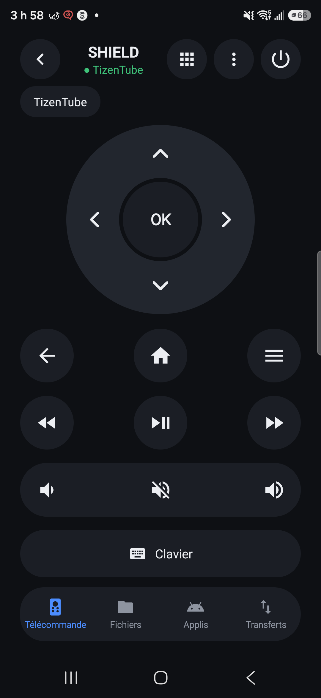
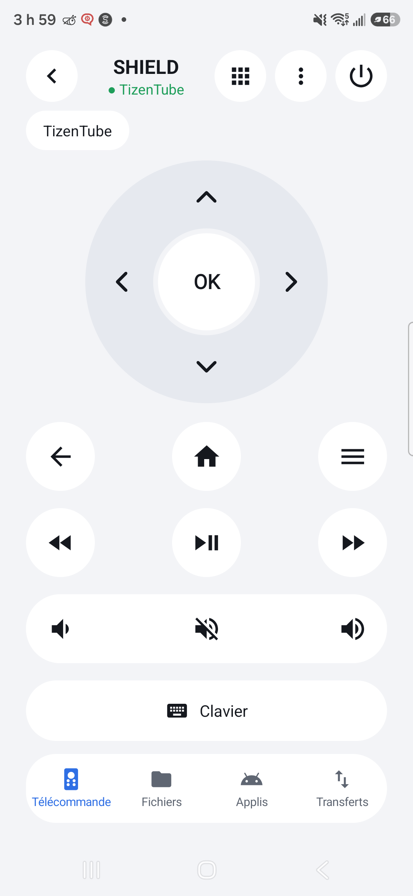
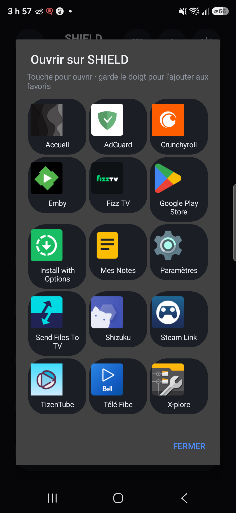
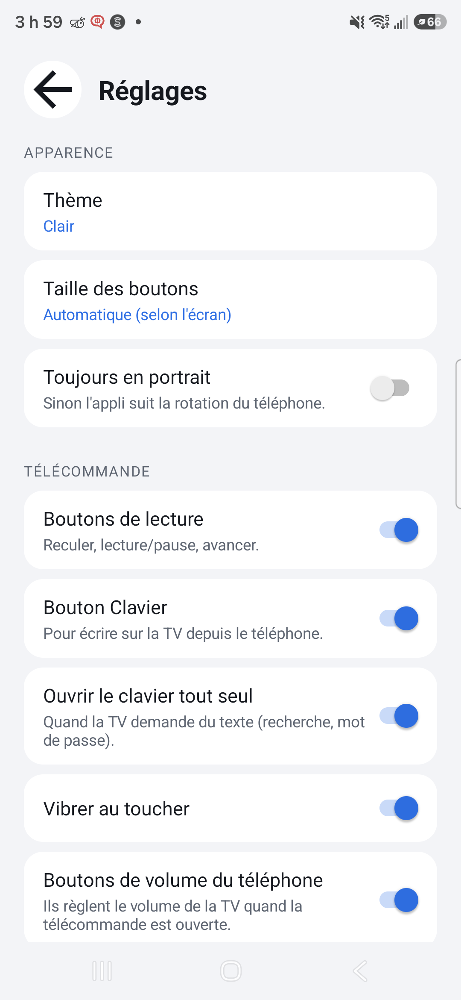
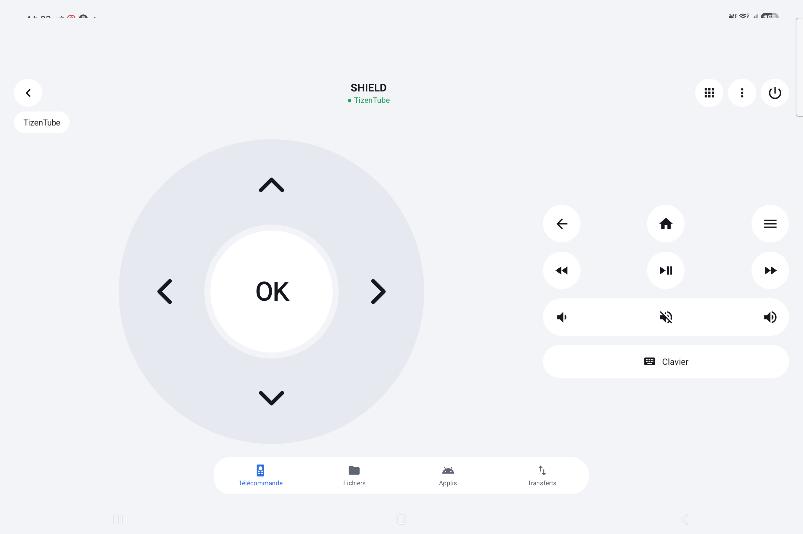

# Nexio

Nexio : une télécommande gratuite et libre pour **Android TV, Google TV et NVIDIA SHIELD**, sur ton téléphone Android,
avec en plus le partage de fichiers et d'applis entre le téléphone, la TV et le PC.

Sans pub, sans compte, sans serveur : tout passe directement par ton Wi-Fi.

<p>




</p>

## Ce qu'elle fait

- **Télécommande** : pavé directionnel, retour, accueil, menu, lecture, volume, marche/veille. Les boutons de
  volume du téléphone règlent la TV.
- **Clavier** : écris sur la TV depuis le téléphone (recherche, mots de passe). Il s'ouvre tout seul quand la TV
  demande du texte.
- **Ouvrir une appli sur la TV** (bouton grille) : toutes les applis de la TV avec leurs icônes. Garde le doigt sur
  une appli pour l'ajouter aux favoris, en raccourcis au-dessus de la télécommande.
- **Minuterie de veille** (bouton ⋮) : la TV se met en veille après 15 min à 2 h, même si l'appli est fermée.
- **Fichiers** : deux panneaux pour copier ou déplacer des fichiers entre le téléphone, la TV et le PC.
- **Applis** : récupère l'APK d'une appli (téléphone ou TV), envoie-la vers un autre appareil, installe-la.
- **Réglages** pour que chacun l'ait à son goût : thème sombre, clair ou comme le téléphone, taille des boutons,
  boutons affichés, vibration, rotation, écran allumé.
- **S'adapte à tous les écrans** : petits téléphones, grands téléphones, tablettes et pliables, en portrait ou
  en paysage.



## Installer

Tout se trouve dans la page **[Releases](../../releases/latest)** :

| Appareil | Fichier | Comment |
|---|---|---|
| Téléphone Android (8.0 ou plus récent) | `Nexio.apk` | Ouvre le fichier sur le téléphone. Android demande d'autoriser l'installation depuis ton navigateur : accepte. |
| TV (pour les fichiers, les applis et les icônes du lanceur) | le même `.apk` | Avec l'appli **Downloader** sur la TV, tape : `github.com/gaara-ux/nexio/releases/latest/download/Nexio.apk`. Ou avec ADB : `adb install Nexio.apk`. |
| PC Windows 10 / 11 | `Nexio.exe` | Voir [Nexio pour Windows](https://github.com/gaara-ux/nexio-windows). |

La télécommande toute seule n'a **rien à installer sur la TV** : elle parle le même protocole que l'appli
Google TV. Nexio sur la TV n'est utile que pour les fichiers, les applis et les icônes du lanceur.

## Premier lancement

1. Le téléphone et la TV doivent être sur le **même Wi-Fi**.
2. Ouvre Nexio : ta TV apparaît dans la liste. Touche-la.
3. Un code à 6 caractères s'affiche sur la TV : tape-le sur le téléphone. C'est fait, une seule fois.
4. Pour les fichiers : ouvre l'onglet **Fichiers**, touche **+ Appareil** et tape le code affiché par l'autre
   appareil (Nexio sur la TV ou sur le PC).

## Questions

**L'écran est noir quand je regarde la TV sur le PC (scrcpy).** C'est normal pour les applis protégées
(Netflix, Fizz, Crave…) : elles interdisent la capture d'écran. La télécommande marche quand même.

**Fire TV ?** Pas encore : Amazon utilise un autre protocole.

**Mes données ?** Rien ne quitte ton réseau. L'appli n'a ni pub, ni statistiques, ni compte.
Elle a besoin de : réseau local (parler à la TV), micro (dictée, seulement quand tu touches le micro),
accès aux fichiers (onglet Fichiers), liste des applis et installation (onglet Applis), alarmes (minuterie).

## Compiler soi-même

JDK 17 et le SDK Android 34, puis :

```
gradlew assembleRelease
```

Sans fichier `keystore.properties`, l'APK est signé avec ta clé de débogage. Aucune dépendance externe :
le protocole de la télécommande (TLS + protobuf) est écrit à la main.

## Signaler un problème

Ouvre une **[Issue](../../issues)** : dis quel téléphone, quelle TV, et ce qui s'est passé. Les idées sont les
bienvenues aussi.

## Licence

[MIT](LICENSE) : libre et gratuit, tu peux l'utiliser, le modifier et le partager.
